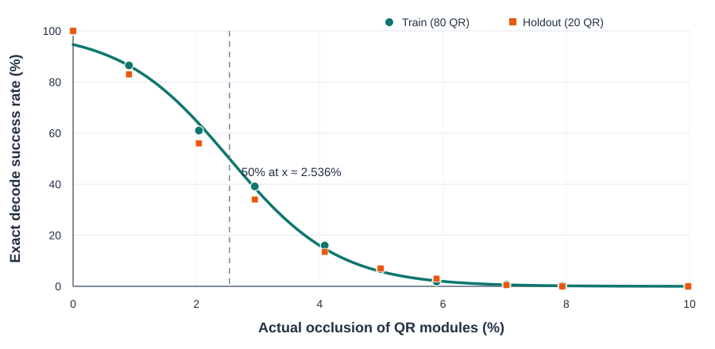

# QRculus

**2026년 2학기 미적분Ⅰ 탐구 — QR코드 가림률에 따른 인식 성공률의 변화와 미분을 이용한 임계 구간 분석**

> ✅ 처음 방문했다면 **[최종 수행평가 보고서](report/미적_주제탐구_2026.pdf)**부터 확인하세요. 탐구 데이터·함수식·그래프·재현 코드를 한 폴더에 정리했습니다.

[📄 보고서 PDF](report/미적_주제탐구_2026.pdf) · [📈 핵심 수학과 그래프](report/README.md) · [🐍 분석 코드](report/reproduce.py) · [📒 다변수 Colab](notebooks/QRculus_multivariate_colab.ipynb) · [📁 예전 자료 안내](docs/LEGACY_INDEX.md)

## 연구 핵심

QR코드의 일부를 분홍색으로 가렸을 때 정확하게 읽히는 비율을 측정하고, **성공률의 급격한 감소 지점은 미분**, **일정 가림률 범위의 평균 성공률은 정적분**으로 분석했습니다.

- 전체 실험: QR코드 100개 × 가림률 15단계 × 2가지 형태 × 오류 정정 4등급, **총 112,400회 판독**(0% 무가림 조건은 400회)
- 보고서의 수학적 분석 범위: **L등급·분산형**, 실제 가림률 약 **0~10%**
- 적합 함수: **R(x) = 100 / (1 + exp[1.1340(x − 2.5362)])**
- **가장 빠른 감소:** 가림률 **2.54%**, 도함수 약 **−28.35** %p/%p
- **정적분 평균:** 가림률 0~10%에서 모델 평균 약 **25.84%**



> 위 25.84%는 관측 성공률 전체 평균이 아니라 **선택한 로지스틱 모델의 정적분 평균**입니다. 무가림에서 모델은 약 94.67%를 예측하지만 관측 성공률은 100%라는 한계도 보고서에 명시했습니다.

## 파일 구조 — 무엇부터 볼까?

| 폴더 | 목적 |
| --- | --- |
| **[report/](report/README.md)** | **현재 제출용** 보고서 PDF, 함수 도출, 관측점 요약, 그래프, 재현 코드 |
| [results/pink_v2/processed](results/pink_v2/processed) | 본 보고서에 사용한 학습·검증 성공률 집계 |
| [results/pink_v2/raw](results/pink_v2/raw) | 전체 112,400회 판독 데이터와 위치 가림 정보 (원본 보존) |
| [notebooks](notebooks) | 위치 탐지 패턴·가림 형태·오류 정정 등급까지 사용하는 별도 다변수 분석 |
| [src/qr_calculus](src/qr_calculus) / [tests](tests) | 실험 원본 생성·재현·검증 코드 |
| [docs/LEGACY_INDEX.md](docs/LEGACY_INDEX.md) | 이번 제출본에 해당하지 않는 **예전 보고서·실험·계획서** 구분 |

## 보고서의 계산 다시 실행

```bash
python -m pip install -r report/requirements.txt
python report/reproduce.py
```

실행하면 `report/outputs/`에 결과 표, 성공률 곡선, 도함수 그림이 생성됩니다. 원본 QR 판독 실험을 다시 돌릴 필요는 없습니다.

**보고서 원본:** [Google Docs에서 편집본 보기](https://docs.google.com/document/d/19v8WVnS3B0Pw0YmnomY5ZR1aeSR90Nio0_T1RBWLmOk/edit)

## 참고

이 저장소에는 과거 **모듈 반전 연구**와 최근 **분홍색 가림 연구**가 모두 남아 있습니다. 과거 실험을 현재 보고서의 데이터로 혼동하지 않도록 [자료 구분표](docs/LEGACY_INDEX.md)를 확인하세요. 기존 자료를 무리하게 삭제하면 결과 재현성 및 Colab 실행이 깨지므로 보존했습니다.
