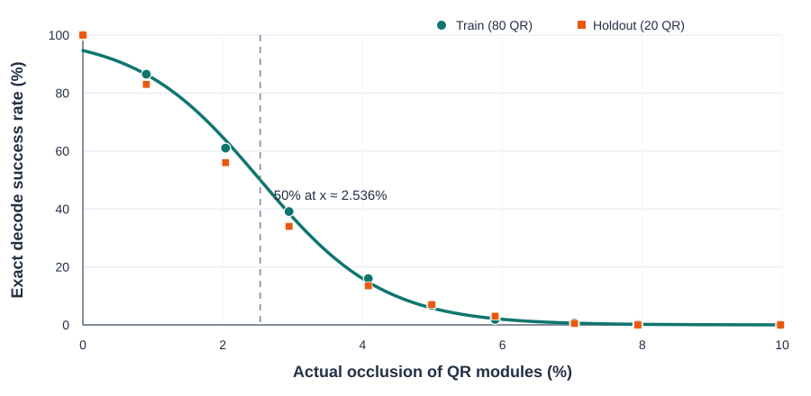
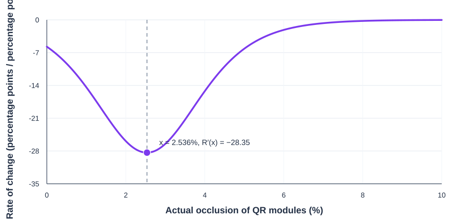

# 2026 미적분Ⅰ 수행평가 — QR코드 가림률과 성공률

> 제출용 보고서는 **단일 변수를 사용한 로지스틱 곡선을 미분·적분하여 해석**합니다. 전체 4변수 머신러닝 실험과 혼동하지 마세요.

**최종 제출본:** [보고서 PDF](./미적_주제탐구_2026.pdf) · [작성 중인 Google Docs 원본](https://docs.google.com/document/d/19v8WVnS3B0Pw0YmnomY5ZR1aeSR90Nio0_T1RBWLmOk/edit)

## 보고서의 실험 범위

- 전체 QRculus 분홍색 가림 실험: **112,400회** / L·M·Q·H 오류 정정 등급 / 분산형·집중형 마스크
- 제출 보고서에서 미적분에 사용하는 집계: **L등급 + 분산형(scattered) + 실제 가림률 0~약 9.977%**
- QR 원문 단위 분리: 학습 80개, 검증 20개. x축은 목표 가림률이 아닌 실제 가림률(가린 모듈 수 / 441 × 100).
- 데이터: [학습 집계](../results/pink_v2/processed/training_summary.csv), [검증 집계](../results/pink_v2/processed/validation_summary.csv), [이 조건의 10점 요약](./data/l_scattered_0_to_10.csv).

## 보고서의 함수·미분·적분

가림률을 x(%), 정확 판독 성공률을 R(x)(%)로 놓았습니다. 아래 근삿값은 학습용 집계 10점의 비가중 최소제곱 로지스틱 적합 결과입니다.

```math
R(x) = \frac{100}{1+e^{1.134018(x-2.536177)}}
```

- **최대 감소 지점:** x ≈ **2.5362%**. 이 지점에서 R(x)=50%.
- **도함수 최솟값:** R′(2.5362) ≈ **−28.35** (%p / 가림률 %p).
- **정적분 평균:** (1/10) ∫₀¹⁰ R(x) dx ≈ **25.84%**. 이 값은 *모델의 구간 평균*이지 실제 전체 QR의 평균 성공률이 아닙니다.
- **검증 집계점 MAE:** 약 **2.456%p** (검증용 20개 QR의 10개 *측정된 가림률* 집계점을 기준). 새로운 가림률에서의 보간 정확도를 검증한 것은 아닙니다.
- **경계조건 한계:** R(0) ≈ **94.67%**, 그러나 실제 무가림 성공률은 100%입니다.

## 보고서에 사용한 그래프



*그림 1. 실제 측정값과 학습 데이터에 적합한 로지스틱 함수.*



*그림 2. x ≈ 2.536%에서 순간 감소율이 가장 큽니다.*

## 그래프·계수 다시 계산하기

저장소 루트에서 실행합니다.

```bash
python -m pip install -r report/requirements.txt
python report/reproduce.py
```

출력은 `report/outputs/`에 생성됩니다: `fit_summary.json`, `observations_and_predictions.csv`, `success_curve.png`, `derivative.png`. QR 원본 생성이나 112,400회 판독을 **다시 실행하지 않습니다**.

## 추가 실험과의 관계

[다변수 Colab](../notebooks/QRculus_multivariate_colab.ipynb)은 가림률·위치 탐지 패턴 가림률·가림 형태·오류 정정 등급을 결합한 **별도의 예측 성능 비교**입니다. 앞서 얻은 4변수 모델 MAE 약 1.759%p는 *모든 등급과 형태에 걸친 다른 검증 방식*의 점수입니다. **단일 조건 로지스틱의 2.456%p와 직접 우열을 비교하면 안 됩니다.**

실험 전체 과정은 [원본 코드](../src/qr_calculus) 및 [2026 분홍색 가림 원자료](../results/pink_v2)를 참고하세요.
