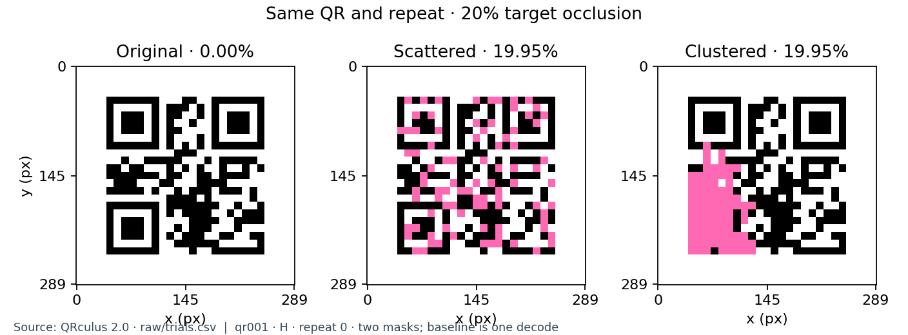
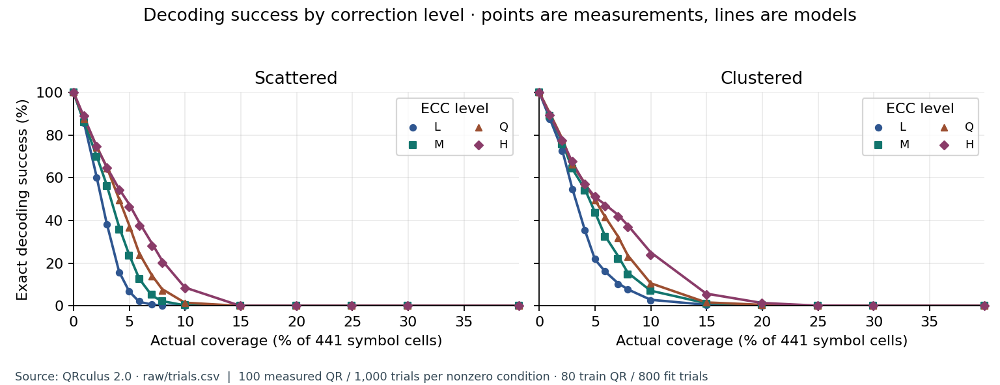

학번: ________　 이름: ________

# 무작위 QR코드의 분홍색 가림 면적과 가림 형태에 따른 판독 성공률

## 동기·목적

QR코드가 비슷한 넓이로 가려져도 읽기 결과가 달라지는 이유를 살펴보았다. 가림률·형태·오류 정정 등급별 판독 성공률을 측정하고, 일차함수의 기울기와 정적분 평균을 비교했다.

가림률이 증가하면 성공률은 대체로 감소하고, 가림 형태에 따라 성공률이 달라질 것으로 가설을 세웠다. 탐지 무늬가 가려지면 검출 실패가 증가할 가능성도 관찰했다.

QR 오류 정정 등급 L/M/Q/H의 약 7/15/25/30%는 코드워드 기준이다. 이번 가림률은 QR 심볼 441개 모듈에 대한 면적 비율이다.

## 실험 설계

| 변인 | 설정 |
| --- | --- |
| 독립 | 0~40%의 15단계, 분산형·집중형, L/M/Q/H |
| 통제 | 버전 1, 마스크 1, 영문 대문자·숫자 6자리, 290×290 RGB |
| 처리 | 441셀 중 k=round(441×목표률/100)개를 #FF69B4로 가림 |
| 종속 | OpenCV가 검출한 위치와 원문 완전 일치를 각각 기록 |
| 표본 | QR 100개(학습 80, 검증 20), 각 QR·형태별 중첩 마스크 10개 |

흰 여백은 보존했다. 분산형은 전체 셀 순열, 집중형은 상하좌우 이웃에서 무작위로 자라는 순서를 썼다. 같은 원문·반복·형태는 같은 셀을 등급별로 가렸다. 0%는 원문·등급당 한 번으로 400회이며 비영 조건은 112,000회였다.

그림 1. 원본과 같은 QR에 적용한 두 가림 형태. 목표 20%, 실제 19.95%.

---

## 탐구 내용

그림 2. 점은 100개 QR의 실측, 선은 학습 80개 QR의 구간별 일차함수다.

실제 가림률 x=100k/441을 사용했다. 인접 측정점 (xᵢ,yᵢ), (xᵢ₊₁,yᵢ₊₁)을 잇는 두 점의 기울기를 mᵢ=(yᵢ₊₁−yᵢ)/(xᵢ₊₁−xᵢ)로 구했다.

`Rᵢ(x)=yᵢ+mᵢ(x−xᵢ)   ·   열린 구간에서 Rᵢ′(x)=mᵢ`

가장 큰 하락 기울기는 L 분산형의 2.0408~2.9478% 구간이었다. 학습 성공률 61.000%와 39.125%를 대입했다.

`R(x)≈61.000+(-24.117)(x−2.0408)`

## 국소 삼차함수

L 분산형의 급락 구간을 감싸는 네 학습점을 택했다. u=x−0.9070이고 유효 범위는 x=0.9070~4.0816%다. 다음 네 식의 u는 반올림했다.

`d=86.500   ·   a(1.1338)³+b(1.1338)²+c(1.1338)+d≈61.000`

`a(2.0408)³+b(2.0408)²+c(2.0408)+d≈39.125   ·   a(3.1746)³+b(3.1746)²+c(3.1746)+d≈16.000`

u>0에서 q=(y−d)/u=au²+bu+c. 인접 q값의 기울기를 e₁₂, e₂₃라 하면 a=(e₂₃−e₁₂)/(u₃−u₁), b=e₁₂−a(u₁+u₂), c=q₁−au₁²−bu₁이다.

`P(u)≈0.825329u³ − 3.41692u² − 19.6779u + 86.5   ·   P′(u)≈2.47599u² − 6.83385u − 19.6779`

P′의 양 끝값 -19.68, -16.42와 꼭짓점 u=−b/(3a)≈1.3800에서의 도함수 값을 비교했다. 최소는 x=2.2871%의 -24.39%p/%p다. 범위·감소 조건을 만족해 모델 추정으로 사용했다.

이 모델은 선택한 네 점 사이에서만 계산했다. 측정은 정수 개수의 셀에서 이루어졌다.

---

## 정적분·결과

인접 구간에서 원시함수 yᵢ(x−xᵢ)+(mᵢ/2)(x−xᵢ)²의 양 끝값 차를 구했다. 각 넓이를 더해 공통 길이 39.9093%로 나눴다.

`∫Rᵢ(x)dx=(yᵢ+yᵢ₊₁)(xᵢ₊₁−xᵢ)/2   ·   평균=구간 적분의 합/범위 길이`

| 등급 | 분산형 평균 | 집중형 평균 | 집중−분산(%p) |
| --- | --- | --- | --- |
| L | 6.54% | 9.36% | +2.82 |
| M | 8.65% | 12.27% | +3.62 |
| Q | 10.53% | 13.73% | +3.21 |
| H | 12.77% | 16.59% | +3.82 |

적분 평균은 H 집중형이 16.59%로 가장 높았다. 112,400회 중 미검출 실패는 47,605회(42.35%), 검출 후 판독 실패는 34,945회(31.09%)였다. H 집중형(설정 5%)에서 탐지 무늬가 하나도 가려지지 않은 337회와 한 칸 이상 가려진 663회의 미검출 실패율은 0.00%, 34.84%였다.

## 알게 된 점·느낀 점

기울기는 가장 빠르게 바뀌는 구간을, 적분 평균은 같은 가림 범위의 전체 성능을 보여 준다. 검출과 정확 판독을 나누어 기록하니 서로 다른 실패 유형을 수치로 비교할 수 있었다.

## 한계·제언

검증 20개 QR에서 일차 모델의 MAE는 곡선별 1.02~2.16%p였다. 위 국소 후보는 4.03%p였다. 검증은 같은 가림률에서 했으므로 중간 가림률의 연속 추정은 별도 검증이 필요하다.

문자열 길이·색·판독기를 고정했고 같은 QR을 10개 마스크에 반복했다. 기능 무늬 가림과 미검출의 관계는 관측 비교이며 인과를 판정하려면 위치를 통제한 추가 실험이 필요하다. 다른 색과 판독기도 비교할 수 있다.

## 참고문헌·출처

본실험 raw/trials.csv 및 processed/summary.csv. 실행 2026-11-20T07:08:40.136015+00:00-pink. Python 3.13.5, OpenCV 4.13.0.92, NumPy 2.3.5.

1. DENSO WAVE, 오류 복원 기능 <https://www.qrcode.com/ko/about/error_correction.html>
2. DENSO WAVE, QR코드 정보량과 버전 <https://www.qrcode.com/ko/about/version.html>
3. OpenCV, QRCodeDetector API <https://docs.opencv.org/4.x/de/dc3/classcv_1_1QRCodeDetector.html>
4. qrcode, PyPI <https://pypi.org/project/qrcode/>
5. NumPy, Random Generator API <https://numpy.org/doc/stable/reference/random/generator.html>
6. QRculus 2.0, 연구 계획과 실행 자료 <https://github.com/hwanghj09/QRculus/tree/main/results/pink_v2>
