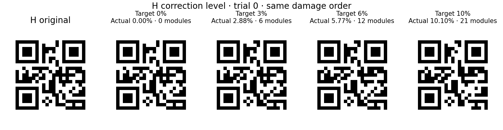
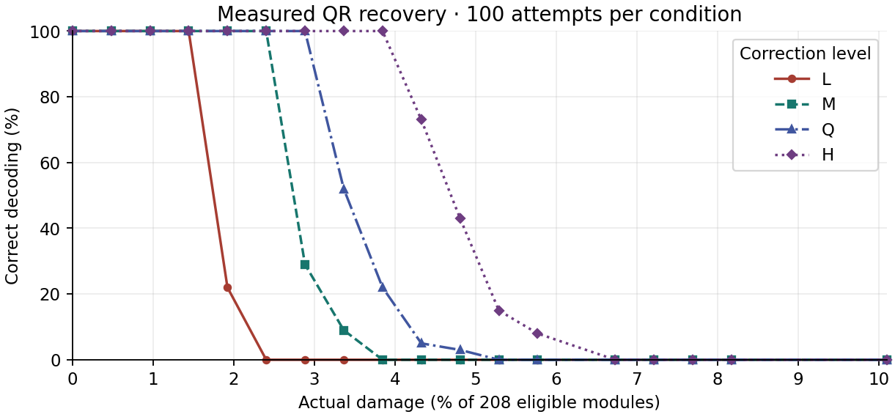

학번: ________　 이름: ________

# QR코드의 손상률에 따른 복원 성공률의 함수적 관계 분석

## 탐구 주제

QR코드에서 데이터·오류 정정 모듈을 뒤집을 때 OpenCV의 복원 성공률을 측정한다. 다항함수의 미분과 정적분으로 급락 구간, 국소 최대 감소 속도, 등급별 구간 평균을 구한다.

## 동기·목적

오류 정정 등급이 실제 판독 결과에 얼마나 영향을 주는지 확인하고 싶었다. 컴퓨터공학에서 생성기와 판독기의 동작을 통제 실험으로 관찰하고, 실측값의 변화를 미적분으로 설명하는 문제다.

QR코드의 위치 탐지·타이밍·형식 정보는 판독에 쓰인다. DENSO WAVE의 약 7/15/25/30%는 코드워드 단위의 복원 능력이다. 이 실험에서 반전한 개별 모듈 비율과는 단위가 다르다.

## 탐구 방법

| 변인 | 실험 설정 |
| --- | --- |
| 독립 | 오류 정정 L/M/Q/H, 설정 손상률 0~8%를 0.5% 간격으로 측정하고 10% 추가 |
| 종속 | 각 조건 100회에서 TEST01을 정확히 판독한 비율 |
| 통제 | 버전 1(21×21), TEST01, 마스크 1, 모듈 10 px, 흰 여백 4모듈, OpenCV |
| 손상 대상 | 예약 모듈 233개와 여백 보존, 데이터·오류 정정 모듈 208개만 XOR 반전 |

① 원본 생성과 판독 확인 → ② 반복 t에서 seed=2026+t로 208개 좌표의 순열 생성 → ③ 앞의 k개를 반전 → ④ 정확히 TEST01이면 성공. 각 t에서 등급들이 좌표를 공유하고 손상 집합은 중첩된다.

`k=round(208×설정률/100)     실제 손상률 x=100k/208 (%)`

총 4×18×100=7,200회이다. 0%는 모든 등급에서 100/100이었다. 설정 10%는 k=21로 실제 10.0962%다. 20회 예비 자료는 참고용으로 보관했다.

그림 1. H의 원본과 같은 반복에서 찍은 손상 예시. 실제 손상률의 분모는 208개.

---

## 탐구 내용

그림 2. 실제 손상률별 복원 성공률. 표식은 측정값이고 선은 구간별 일차 모델이다.

| 설정 % | 실제 % | L | M | Q | H |
| --- | --- | --- | --- | --- | --- |
| 0 | 0.000 | 100% | 100% | 100% | 100% |
| 2 | 1.923 | 22% | 100% | 100% | 100% |
| 3 | 2.885 | 0% | 29% | 100% | 100% |
| 4 | 3.846 | 0% | 0% | 22% | 100% |
| 5 | 4.808 | 0% | 0% | 3% | 43% |
| 6 | 5.769 | 0% | 0% | 0% | 8% |
| 10 | 10.096 | 0% | 0% | 0% | 0% |

인접 두 점 (xᵢ,yᵢ), (xᵢ₊₁,yᵢ₊₁)을 잇는 직선의 기울기는 mᵢ=(yᵢ₊₁−yᵢ)/(xᵢ₊₁−xᵢ)다.

`Rᵢ(x)=yᵢ+mᵢ(x−xᵢ)   (xᵢ≤x≤xᵢ₊₁)     내부 도함수 Rᵢ′(x)=mᵢ`

정적분은 [yᵢ(x−xᵢ)+(mᵢ/2)(x−xᵢ)²]의 양 끝값 차이다. mᵢ를 대입하면 (yᵢ+yᵢ₊₁)(xᵢ₊₁−xᵢ)/2다. 각 면적을 더해 공통 구간 길이 100×21/208로 나눈다.

H에서 x=4.327~4.808%일 때 Rᵢ(x)≈73+(-62.40)(x−4.327). 이 구간의 적분은 27.88다.

## 국소 삼차함수 유도

H의 최급락 구간을 포함하는 k=8~11을 골랐다. u=k−8, 0≤u≤3이고 x=100(8+u)/208이다. 네 점의 성공률은 100, 73, 43, 15%다.

`d=100, a+b+c+d=73, 8a+4b+2c+d=43, 27a+9b+3c+d=15`

이웃 식을 빼면 6a=y₃−3y₂+3y₁−y₀, 6a+2b=y₂−2y₁+y₀, c=y₁−y₀−a−b다.

`P(u)=(5/6)u³ − 4u² − (143/6)u + 100     P′(u)=(5/2)u² − 8u − 143/6`

P′의 양 끝값 -23.83, -25.33와 구간 내 꼭짓점을 비교했다. 꼭짓점 u=−b/(3a)=1.60에서 최소이고 P′=-30.23%p/모듈, x=4.615%다. 유효 범위는 x=3.846~5.288%다.

[au⁴/4+bu³/3+cu²/2+du]₀³을 3으로 나눈 국소 평균은 57.88%다. 이 값은 위 네 점이 정한 구간에 적용된다.

---

## 결과 및 알게 된 점

| 등급 | 가장 빠른 감소 구간 | 기울기¹ | 정적분 평균 |
| --- | --- | --- | --- |
| L | 1.442–1.923% | -162.24 | 17.71% |
| M | 2.404–2.885% | -147.68 | 28.00% |
| Q | 2.885–3.365% | -99.84 | 34.86% |
| H | 4.327–4.808% | -62.40 | 47.29% |

¹ 성공률 %p / 실제 손상률 %p. 정적분 평균은 모든 등급에서 0~10.0962%의 공통 범위로 계산했다.

평균은 H > Q > M > L 순이었다. H와 L의 차이는 29.57%p였다. 기울기는 가장 급한 변화 구간을, 정적분 평균은 공통 범위의 전체 성능을 보여 준다. L, M, Q의 국소 후보는 범위 초과 또는 구간 내 증가가 있어 해석에서 제외했다.

보조 실험은 각 k에서 새 시드 2126~2155로 30회씩 시행했다. H의 평균절대오차는 4.42%p다. 이 오차는 같은 정수 k에서의 재측정 차이를 보여 준다. 네 점 사이 연속 구간의 예측은 검증 범위 밖이다.

## 탐구 한계

좌표 선택 편차를 줄이기 위해 같은 반복의 순열을 공유했다. 예약 모듈과 여백을 보존하고, 반올림 오차를 처리하기 위해 설정률과 실제율을 모두 기록했다. 보간의 과도한 진동은 도함수 부호와 극값으로 확인했다.

메시지·마스크·버전·판독기를 하나씩 고정했다. 모듈 반전만 다루므로 얼룩, 가림, 회전, 촬영 조건에 따른 성능은 별도 측정이 필요하다. 조건당 100회여서 성공률의 해상도는 1%p다.

## 느낀 점·제언

기울기가 가장 큰 폭으로 내려가는 시점과 일정 범위에서의 성능은 서로 다른 질문임을 알았다. 다음에는 메시지·마스크·QR 버전을 바꾸고, 집중 손상과 분산 손상 및 다른 판독기를 비교한다.

## 참고문헌·출처

본실험 원자료 trials.csv, 집계 success_rate.csv, 분석 analysis_details.json. 실행 ID 20261119T235639Z-b9c239b5cdd8. Python 3.13.5, OpenCV 4.13.0.92, qrcode 8.2, NumPy 2.3.5. 세부 환경은 environment.json.

1. DENSO WAVE, 오류 복원 기능 <https://www.qrcode.com/ko/about/error_correction.html>
2. DENSO WAVE, QR코드 정보량과 버전 <https://www.qrcode.com/ko/about/version.html>
3. ISO/IEC 18004:2024, QR code bar code symbology specification <https://www.iso.org/standard/83389.html>
4. qrcode 8.2, PyPI <https://pypi.org/project/qrcode/8.2/>
5. OpenCV, QRCodeDetector API <https://docs.opencv.org/4.x/de/dc3/classcv_1_1QRCodeDetector.html>
6. NumPy, Random Generator API <https://numpy.org/doc/stable/reference/random/generator.html>
