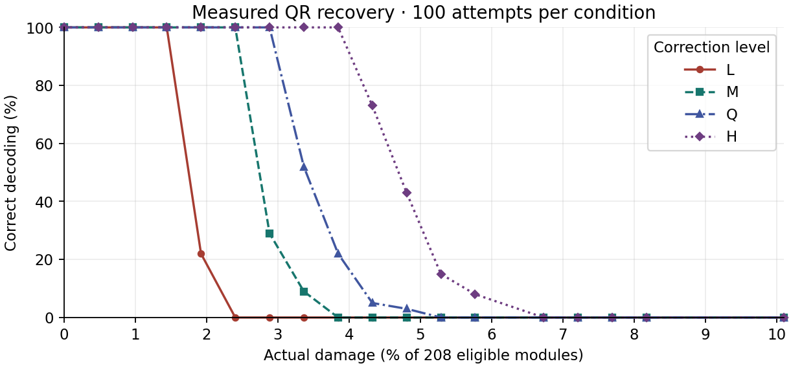
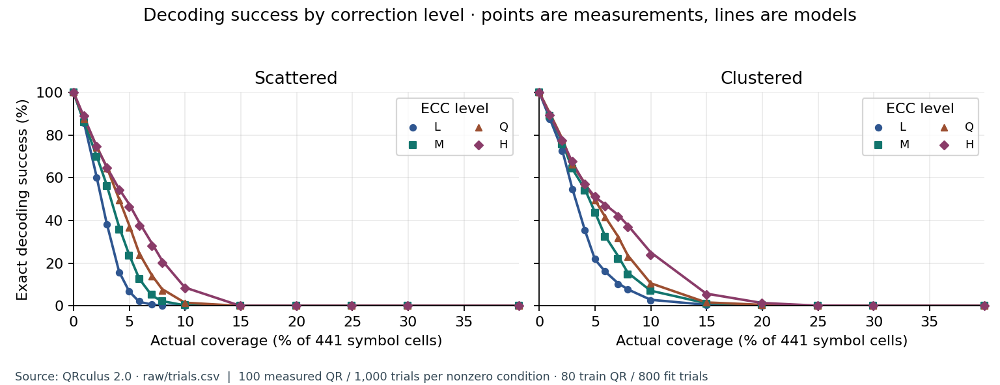

학번: ________　 이름: ________

# QR코드의 모듈 반전과 분홍색 가림에 따른 판독 성공률 분석

## 탐구 주제와 동기·목적

QR코드가 일부 손상되어도 읽히는 이유에 관심을 갖고, 손상 비율에 따라 판독 성공률이 얼마나 빠르게 떨어지는지 알아보았다. 첫 실험에서 데이터 영역을 반전해 오류 정정 등급을 비교했다. 이어 실제 오염과 비슷하게 분홍색으로 덮고, 같은 면적에서도 가림 형태에 따라 결과가 달라지는지 확인했다. 실측점을 다항함수로 연결해 도함수와 정적분으로 분석했다.

## 탐구 방법

| 구분 | 실험 1 · 모듈 반전 | 실험 2 · 분홍색 가림 |
|---|---|---|
| 원문 | TEST01 한 종류 | 고유 영문·숫자 6자리 100개 |
| 손상률의 분모 | 데이터·오류 정정 모듈 208개 | 기능 패턴을 포함한 심볼 441개 |
| 처리 | 선택한 모듈을 흑백 반전 | 분산 또는 연결된 셀에 #FF69B4 덧칠 |
| 시행 | 4등급×18조건×100회 = 7,200회 | 양의 가림률 112,000회와 무가림 400회 |
| 분석 | 본실험 전체로 보간 | QR 80개로 보간, 나머지 20개로 검증 |

두 실험 모두 QR 버전 1(21×21), 마스크 1, L·M·Q·H 등급, 사방 4모듈 흰 여백, OpenCV 판독기를 사용했다. 원문과 판독 문자열이 완전히 같으면 성공으로 기록했다. 같은 반복에서 등급별로 손상 좌표를 공유했고, 비율이 커지면 기존 손상 위치에 새 위치를 추가했다. 실험 2에서는 사각형 검출 여부도 기록했다.

실제 손상률 x는 전체 후보 N개 중 바꾼 k개에 대해 x=100k/N으로 계산했다. k는 목표 손상률에 맞춰 정수로 반올림했다. 공식 오류 정정 수치 약 7/15/25/30%의 단위는 코드워드다. 이미지에서 바뀐 모듈 비율과는 측정 단위가 다르다.

---

## 탐구 내용 · 미분과 정적분

인접 실측점 (xᵢ,yᵢ), (xᵢ₊₁,yᵢ₊₁)에서 Δx=xᵢ₊₁−xᵢ, mᵢ=(yᵢ₊₁−yᵢ)/Δx로 놓았다. 두 점을 잇는 함수는 Rᵢ(x)=yᵢ+mᵢ(x−xᵢ)이고, 열린 구간에서 Rᵢ′(x)=mᵢ이다. 가장 작은 기울기를 급락 구간의 변화율로 해석했다.

실험 1의 H는 9개→10개 반전 시 73%→43%였다. 두 점 사이의 기울기는 (43−73)/(100/208)=−62.40이며, R(x)=73−62.4(x−900/208)이다. 실험 2에서 가장 가파른 학습 구간은 L 분산형의 실제 2.0408–2.9478%로, 61.000%→39.125%, 기울기는 −24.12%p/%p였다.

각 구간의 원시함수 yᵢ(x−xᵢ)+(mᵢ/2)(x−xᵢ)²에 양 끝을 대입하면 정적분은 (yᵢ+yᵢ₊₁)Δx/2다. 예를 들어 실험 1의 위 H 구간 면적은 (73+43)/2×(100/208)≈27.88이다. 모든 구간의 면적을 합해 전체 구간 길이로 나누면 정적분 평균 성공률을 얻는다.

## 국소 삼차함수 · 실험 1의 H

k=8, 9, 10, 11일 때 실측값은 100, 73, 43, 15%였다. u=k−8로 두고 P(u)=au³+bu²+cu+d에 대입하면 다음 연립식이 된다.

**d=100, a+b+c+d=73, 8a+4b+2c+d=43, 27a+9b+3c+d=15**

세 번째 차분으로 6a=15−3×43+3×73−100=5, 두 번째 차분으로 6a+2b=43−2×73+100=−3이다. 따라서 a=5/6, b=−4, c=−143/6이다.

**P(u)=(5/6)u³−4u²−(143/6)u+100, P′(u)=(5/2)u²−8u−143/6**

양 끝 u=0, 3과 꼭짓점 u=8/5를 비교하면 최솟값은 꼭짓점에서 −30.23%p/모듈이다. 실제 반전률 4.6154%에 해당하는 모델 추정값이다. 적용 범위는 3.8462–5.2885%이며, 같은 정수 k를 새 시드로 재측정한 평균절대오차는 4.42%p였다.

---

## 결과 및 알게 된 점

| 등급 | 반전 평균 · 0–10.0962% | 분산 가림 평균 · 0–39.9093% | 집중 가림 평균 · 0–39.9093% |
|---|---:|---:|---:|
| L | 17.71% | 6.54% | 9.36% |
| M | 28.00% | 8.65% | 12.27% |
| Q | 34.86% | 10.53% | 13.73% |
| H | 47.29% | 12.77% | 16.59% |

반전 실험에서는 H의 적분 평균이 가장 높았다. 가림 실험에서는 학습용 80개 QR로 계산한 평균이 네 등급 모두 집중형에서 높았다. 전체 100개 실측에서도 형태 차이가 확인됐다. 예를 들어 M의 목표 가림률 5%에서는 집중형 43.6%, 분산형 23.5%로 20.1%p 차이가 났다.

가림 실험에서는 미검출 실패 47,605회와 검출 후 판독 실패 34,945회를 구분했다. H 집중형의 목표 5% 조건에서 위치 탐지 무늬가 가려진 경우의 미검출 실패율은 34.84%(663회 중), 가려지지 않은 경우는 0%(337회 중)였다. 가린 나머지 위치의 영향도 함께 포함된 관측 결과다.

## 탐구 한계·어려움과 해결

정수 모듈로 처리하면서 목표 비율과 실제 비율이 달라져 실제 비율로 기울기와 적분을 계산했다. 두 실험의 분모, 손상 방식, 원문과 범위가 함께 바뀌었으므로 표의 실험 간 차이만으로 손상 방식의 효과를 추정할 수 없다. 같은 실험 안에서 등급이나 형태를 비교했다. 가림 실험의 검증용 20개 QR에서 일차 모델의 평균절대오차는 곡선별 1.02–2.16%p였으며, 같은 가림률에서 평가했다. 정수 모듈 사이의 연속값은 보간에 따른 추정이다.

## 느낀 점·후속 탐구

가장 빠르게 성공률이 떨어지는 구간과 전체 범위에서의 성능이 서로 다른 질문임을 알게 됐다. 후속 연구에서는 같은 원문, 같은 후보 영역과 비율 격자에서 반전과 가림을 비교하고, 탐지 무늬의 가림 여부를 별도로 통제해 보고 싶다.

## 참고문헌·출처

1. [DENSO WAVE, QR코드의 오류 복원 기능](https://www.qrcode.com/ko/about/error_correction.html)
2. [OpenCV, QRCodeDetector API](https://docs.opencv.org/4.x/de/dc3/classcv_1_1QRCodeDetector.html)
3. QRculus 실측 및 분석 자료 · [모듈 반전](../results/final/) · [분홍색 가림](../results/pink_v2/). 두 본실험은 Python 3.13.5, OpenCV 4.13.0.92 환경에서 수행했다.
